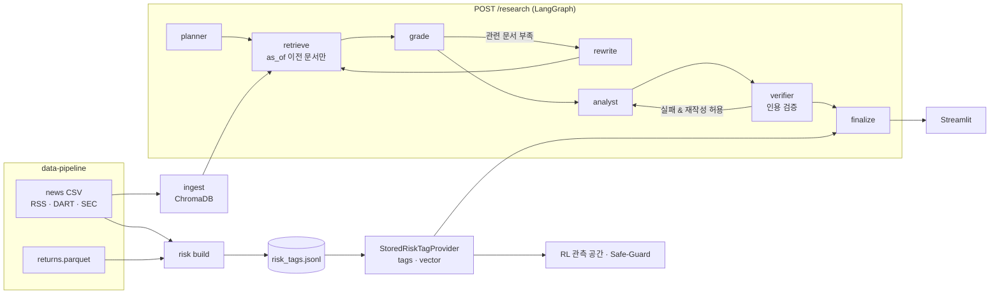

# Agentic Research

에이전틱 RAG + 강화학습 기반 로보어드바이저 프로젝트의 **Agentic Research** 파트다.
LangGraph 기반 계획-수행-검증 워크플로우로 금융 뉴스·공시를 교차 분석해 인용이 포함된
리서치 리포트를 만들고, 강화학습 엔진·Safe-Guard가 소비하는 **리스크 태그(RiskTag)**를 생성한다.

구현 계획과 진행 상황은 이 레포의 [Issues](../../issues)에서, 팀 결정이 필요한 항목(D1~D13)은
Notion「Agentic Research 구현 계획 · 의사결정」에서 관리한다. 결정 항목은 모두 `.env` 설정값이다.

## 팀 레포와의 관계

| 레포 | 이 레포와의 연결 |
| --- | --- |
| [data-pipeline](https://github.com/codyssey-dmu-2026/data-pipeline) | `data/raw/news/{asset}.csv`(뉴스·DART·SEC)와 `data/processed/returns.parquet`를 읽기 전용으로 사용한다. 수집은 data-pipeline 담당. |
| [evaluation-xai](https://github.com/codyssey-dmu-2026/evaluation-xai) | `evaluation_xai.contracts.RiskTag`를 커밋 고정 의존성으로 가져와 그대로 쓴다(스키마 복사 없음). |
| RL 엔진 | `StoredRiskTagProvider.vector(decision_at, asset_order)`로 자산별 리스크 값을 관측 공간·Safe-Guard에 넣는다. |
| 프론트 | `POST /research` 응답의 `trace`(추론 로그), `citations`, `risk_tags`를 대시보드에 표시한다. |

## 아키텍처



```
src/agentic_research/
├── contracts.py   # NewsRecord·Hit·Draft·TraceEvent·요청/응답, RiskTag 재수출
├── ports.py       # NewsSource·EmbeddingPort·VectorStorePort·LLMPort·RiskTagProvider
├── wiring.py      # .env로 구현 선택 (유일한 선택 지점)
├── news.py        # data-pipeline CSV 로더, 가용 시점(available_at) 정책
├── vectorstore.py # ChromaDB, as_of·자산 필터
├── embeddings.py  # HashEmbedding(오프라인) · OpenAIEmbedding
├── llm.py         # RuleBasedLLM(키 없이 동작) · OpenAILLM(구조화 출력)
├── workflow.py    # LangGraph 그래프와 Self-Correction 루프
├── verifier.py    # 인용 검증
├── research.py    # 요청 1건 실행 → 응답
├── api.py         # FastAPI: GET /health, POST /research
├── risk/          # taxonomy · taggers · provider · `python -m agentic_research.risk`
├── ingest.py      # `python -m agentic_research.ingest`
├── evaluate.py    # Self-Correction 전후 인용 품질
└── bench.py       # /research 지연 시간 (5초 기준)
```

## 실행

### 로컬 (Python 3.12 또는 3.13)

```bash
python3.13 -m venv .venv && source .venv/bin/activate
pip install -r requirements.txt && pip install -e . --no-deps
cp .env.example .env   # OPENAI_API_KEY와 data-pipeline 경로 입력, 커밋 금지

python -m agentic_research.ingest   # 뉴스·공시 → ChromaDB (재실행해도 중복 없음)
python -m agentic_research.risk     # RiskTag 생성 → artifacts/risk_tags.jsonl (API 재시작 시 반영)
python -m uvicorn agentic_research.api:app --port 8001
```

키가 없으면 `AGENT_LLM_PROVIDER=rule`, `AGENT_EMBEDDING_PROVIDER=hash`(기본값)로 전 과정이 동작한다.
이때 응답의 `llm_provider`는 `"rule"`이며, 분석은 키워드 규칙 기반이다.

### Docker

```bash
NEWS_DIR=../data-pipeline/data/raw/news PROCESSED_DIR=../data-pipeline/data/processed \
  docker compose up --build
docker compose exec agent-api python -m agentic_research.ingest
docker compose exec agent-api python -m agentic_research.risk
```

- Health: <http://127.0.0.1:8001/health>, Swagger UI: <http://127.0.0.1:8001/docs>
- 포트 8001은 evaluation-xai API(8000)와의 충돌을 피하기 위한 값이다.

### 검사

```bash
python -m black --check src tests
python -m flake8 src tests
python -m pytest --cov=agentic_research
```

## API

`POST /research`

```json
{"question": "엔비디아 2024년 실적 발표", "tickers": ["NVDA"], "as_of": "2024-12-31T00:00:00-05:00"}
```

- `as_of`(시간대 필수, 생략 시 현재)보다 **나중에 공개된 문서는 검색되지 않는다**.
- `tickers`를 생략하면 질문에서 자산명을 찾는다(`삼성전자의` 같은 조사는 허용, `애플리케이션`은 제외).
- 응답: `answer`, `opinion`(비중 확대/유지/비중 축소), `confidence`, `claims`(문장별 인용 번호),
  `citations`(제목·게시일·원문 URL), `risk_tags`(as_of에 유효한 태그), `trace`(노드별 메시지·소요 시간),
  `rewrites`, `revisions`, `insufficient_evidence`, `disclaimer`.
- 오류: 422 시간대 없는 `as_of`, 502 LLM·임베딩 호출 실패, 503 제공자 미설정 또는 벡터 저장소 비어 있음.

## Self-Correction과 인용 검증

LLM은 그럴듯하지만 근거 없는 문장을 만든다. 금융 리포트에서는 이 환각이 곧 잘못된 투자 판단이므로,
두 단계에서 스스로 고친다.

1. **검색 재작성**: 관련성(코사인 유사도) `AGENT_RELEVANCE_THRESHOLD` 이상 문서가 `AGENT_MIN_RELEVANT_DOCS`건
   미만이면 실패 사유를 근거로 검색어를 고쳐 재검색한다. 최대 `AGENT_MAX_REWRITES`회.
   기준 시점 이전 문서가 하나도 없으면 재작성해도 소용없으므로 바로 "근거 부족"으로 끝낸다.
2. **인용 검증**: 모든 주장은 (1) 인용이 있고 (2) 인용 번호가 실제 검색된 문서이며 (3) 인용 문서가 주장을
   뒷받침해야 한다. 실패하면 사유를 붙여 재작성시키고(최대 `AGENT_MAX_REVISIONS`회), 끝까지 통과하지 못한
   주장은 리포트에서 **삭제**한다. 검증된 주장이 하나도 없으면 의견은 "유지", 신뢰도 0으로 내보낸다.

따라서 최종 응답의 인용 URL은 항상 검색된 문서의 부분집합이다.

## 리스크 태그 (RL 연동)

```python
from datetime import datetime
from pathlib import Path
from agentic_research.risk.provider import StoredRiskTagProvider

provider = StoredRiskTagProvider.from_jsonl(Path("artifacts/risk_tags.jsonl"))
order = ["000660", "005930", "069500", "148070", "AAPL", "GLD",
         "MSFT", "NVDA", "QQQ", "SPY", "TLT", "VNQ"]          # returns.parquet 컬럼 순서
vec = provider.vector(datetime.fromisoformat("2024-08-06T09:00:00+09:00"), order)
# shape (12,), 자산별 max(severity × confidence), 유효한 태그가 없으면 0
```

| 출처 | risk_type | 가용 시점 | 대상 |
| --- | --- | --- | --- |
| 일간 수익률 \|z\| ≥ 3 (직전 60거래일 표준편차) | price_shock | 그날 종가 (KRX 15:30 KST, 미국 16:00 ET) | 12개 자산, 2018년~ |
| 실적 공시(10-K·10-Q·DART 실적) 이후 첫 거래일 \|z\| ≥ 2 | earnings_shock | 그 거래일 종가 | 공시가 있는 종목 |
| 뉴스·DART 제목/요약을 LLM(또는 키워드 규칙)으로 분류 | earnings_shock, regulation, litigation, geopolitical, macro_rate | 원문 가용 시점 | 해당 종목 + 거시 위험은 ETF로 전파 |

- 원문 가용 시점: 시각이 있는 뉴스·SEC 접수 시각은 그대로, 날짜만 있는 DART·SEC filingDate는 원 시장 시간대 기준 다음 날 00:00.
- 모든 z-score는 그날 이전 수익률만 쓴다. 사후에 만든 태그는 `mode="historical_replay"`로 실제 생성 시각을 남긴다.
- `tag_id`는 (자산, 유형, 출처 URL, 게시 시각)의 해시라서 다시 만들어도 같다. 결정 로그의 `risk_tag_ids`에 쓸 수 있다.
- 유효기간·임계값·ETF 매핑은 Notion D4·D7·D8 결정값이며 `.env`로 바꾼다.

## 측정 결과 (2026-10-22)

조건: data-pipeline `0bbd15f`를 직접 실행해 얻은 데이터(SEC 346건, 한국경제 RSS 3건, DART는 API 키가 없어 0건),
`gpt-4o-mini` + `text-embedding-3-small`, 기본 설정. 질문 10개는 `evaluation/questions.json`.

**지연 시간** (`python -m agentic_research.bench --n 20`): p50 3.42초, p95 4.17초, 최대 5.18초(20건 중 1건 5초 초과).
LLM 계획(+약 1초)과 초안 재작성(+약 3초)을 켜면 5초를 넘기므로 기본값은 꺼져 있다(Notion D13).

**인용 품질** (`python -m agentic_research.evaluate`):

| 지표 | baseline | 검색 재작성 | 검색 재작성 + 초안 재작성 1회 |
| --- | --- | --- | --- |
| 초안 주장 중 인용 없는 비율 | 0% | 0% | 0% |
| 초안 주장 중 검색되지 않은 문서 인용 | 0% | 0% | 0% |
| 초안 주장 중 근거가 뒷받침하지 않는 비율 | 26.9% | 34.6% | 34.6% |
| 최종 검증 통과 비율 | 73.1% | 65.4% | 72.0% |
| 근거 부족 응답 비율 | 20% | 30% | 20% |
| p95 지연 | 4.2초 | 4.2초 | 9.0초 |

- 초안 주장의 27~35%가 인용 문서로 뒷받침되지 않았고, 검증 단계가 이를 모두 삭제했다.
- 이 데이터에서는 관련성 기준(0.3)을 항상 넘어서 검색 재작성이 한 번도 발생하지 않았다(평균 0회).
  baseline과 검색 재작성 열의 차이는 LLM 출력의 변동이다.

## 한계점

- **과거 뉴스 부족**: RSS는 최근 스냅샷이라 2018~2025 학습 구간의 텍스트 태그가 거의 없다. 과거 구간은 가격·공시 기반 태그가 담당한다.
- **LLM 사전지식 누수**: `available_at` 필터는 문서 누수만 막는다. 모델이 학습 시점에 알던 미래 사실을 쓰는 것은 막지 못하므로, 프롬프트로 "제공된 문서만 사용"을 지시하고 인용 검증으로 문서 밖 주장을 삭제한다.
- **SEC 본문 없음**: SEC는 제목이 `{양식} ({기간})`뿐이라 양식 설명을 붙여 검색하고, 텍스트 태깅에서는 제외한다. 8-K는 사건 유형을 알 수 없어 실적 반응 태그에서도 제외한다.
- **규칙 기반 모드**: 키 없이 도는 `rule`/`hash`는 어휘 일치 기반이라 의미 검색 품질이 낮다. CI·오프라인 시연용이다.
