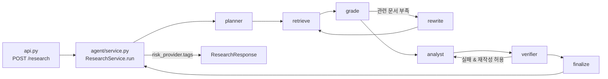
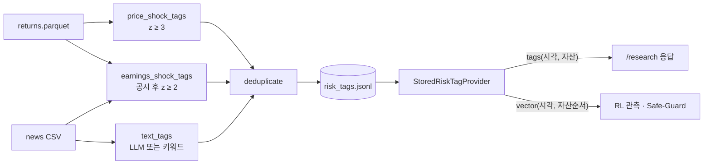

# 코드 읽기 가이드

`src/agentic_research/`를 처음 읽는 사람을 위한 안내다. 실행 방법과 측정 결과는 [README](../README.md)에 있다.

## 패키지 구조

```
src/agentic_research/
├── config.py · contracts.py · ports.py · assets.py   공용: 설정, 데이터 모양, 인터페이스, 자산
├── wiring.py        .env를 보고 구현을 고르는 유일한 곳
├── api.py           FastAPI (uvicorn agentic_research.api:app)
├── ingest.py        python -m agentic_research.ingest
├── corpus/          뉴스·공시를 시점별로 검색 가능하게
│   ├── news.py          data-pipeline CSV 로더, available_at 정책
│   ├── embeddings.py    HashEmbedding · OpenAIEmbedding
│   └── vectorstore.py   ChromaDB, as_of·자산 필터
├── llm/             LLMPort 구현
│   ├── rule.py          RuleBasedLLM (키 없이 동작)
│   └── openai.py        OpenAILLM (structured output)
├── agent/           LangGraph 리서치 에이전트
│   ├── workflow.py      그래프 조립과 노드 로직
│   ├── verifier.py      인용 검증
│   ├── service.py       요청 1건 실행 → 응답
│   ├── evaluate.py      python -m agentic_research.agent.evaluate
│   └── bench.py         python -m agentic_research.agent.bench
└── risk/            RiskTag 생성과 제공 (python -m agentic_research.risk)
```

패키지끼리는 서로를 직접 쓰지 않고 공용 모듈(`contracts`, `ports`, `config`, `assets`)을 통해서만 만난다. 구현을 조립하는 곳은 `wiring.py`이고, 이를 쓰는 건 실행 진입점(`api.py`, `ingest.py`, `risk/__main__.py`, `agent/evaluate.py`)뿐이다. 예외는 두 개다. `risk/taxonomy.py`는 위험 유형 어휘라서 `contracts`·`config`·`llm`도 가져다 쓰고, `agent/workflow.py`는 LLM 계획을 끈 경우 `llm/rule.py`의 규칙 계획을 쓴다.

## 읽는 순서

1. `contracts.py`: 주고받는 데이터 모양. `NewsRecord`, `Hit`, `Draft`, `Claim`, `TraceEvent`, 요청/응답.
2. `ports.py`: 외부 의존(LLM, 임베딩, 벡터 저장소, RiskTag)의 인터페이스.
3. `agent/workflow.py`: LangGraph 그래프. 이 파일을 이해하면 흐름의 대부분이 잡힌다.
4. `agent/verifier.py`: 인용 검증.
5. `agent/service.py`: 그래프 실행 결과를 API 응답으로 바꾼다.
6. `api.py`: FastAPI 엔드포인트.
7. `risk/provider.py`: RL 엔진이 호출하는 `vector()`.

## 요청 하나가 지나가는 길



그래프는 서비스가 처음 만들어질 때 한 번 조립되고(`agent/service.py:24`, `build_workflow`), 요청마다 `invoke`로 실행된다(`agent/service.py:30`). 서비스는 첫 요청(`/health` 포함) 때 만들어져 `lru_cache`로 재사용된다(`api.py:26`). 그래서 `.env`를 바꾸면 서버를 재시작해야 반영된다.

| 노드 | 하는 일 | 위치 |
| --- | --- | --- |
| planner | 질문을 검색어 최대 4개로 나눈다. 기본은 규칙 기반이고 `AGENT_LLM_PLANNER=true`면 LLM | `agent/workflow.py:82` |
| retrieve | `as_of` 이전에 공개된 문서만 검색, URL 기준 중복 제거 | `agent/workflow.py:101`, `corpus/vectorstore.py:78` |
| grade | 관련성 `AGENT_RELEVANCE_THRESHOLD` 이상 문서가 `AGENT_MIN_RELEVANT_DOCS`건 이상인지 | `agent/workflow.py:121` |
| rewrite | 실패 사유를 넣어 검색어를 고친다. 최대 `AGENT_MAX_REWRITES`회 | `agent/workflow.py:154` |
| analyst | 근거 문서 번호를 단 주장(claim)으로 초안 작성 | `agent/workflow.py:170`, `llm/openai.py:88` |
| verifier | 주장마다 인용 존재, 인용 번호 유효, 근거가 주장을 뒷받침하는지 검사 | `agent/workflow.py:190`, `agent/verifier.py:36` |
| finalize | 통과한 주장만 남긴다 | `agent/workflow.py:218` |

모든 노드는 `TraceEvent`를 하나씩 남긴다. 상태의 `trace` 필드가 `operator.add`로 누적되기 때문이다(`agent/workflow.py:63`). 이 목록이 응답의 `trace`, 즉 대시보드의 "에이전트 현재 생각" 로그가 된다.

## 핵심 설계 4가지

### 1. Port와 wiring: 구현 교체를 설정으로

`ports.py`는 `Protocol`만 정의한다. 실제 구현을 고르는 곳은 `wiring.py` 한 곳뿐이다.

| 설정 | 키 없이 (기본값) | OpenAI 키가 있을 때 |
| --- | --- | --- |
| `AGENT_LLM_PROVIDER` | `rule` → `llm/rule.py` `RuleBasedLLM` (키워드 규칙) | `openai` → `llm/openai.py` `OpenAILLM` (structured output) |
| `AGENT_EMBEDDING_PROVIDER` | `hash` → `HashEmbedding` (어휘 해시) | `openai` → `OpenAIEmbedding` |

키 없이도 전 과정이 돌기 때문에 CI와 오프라인 시연이 가능하다. 대신 `rule`/`hash` 모드의 품질은 낮다. 새 구현은 `tests/contracts/`의 계약 테스트를 통과하면 교체할 수 있다.

### 2. 시점(as_of) 필터: 미래 정보 누수 방지

- 문서마다 `available_at`(쓸 수 있게 되는 시각)이 있다(`corpus/news.py:49`).
  - 시각이 있는 뉴스와 SEC 접수 시각은 게시 시각 그대로 쓴다.
  - 날짜만 있는 DART와 SEC filingDate는 원래 시장 시간대 기준 **다음 날 00:00**부터 쓴다. 그날 언제 공개됐는지 몰라도 다음 날 00:00에는 확실히 공개돼 있기 때문이다. SEC는 오후 5:30(ET) 이후 접수분의 공시일을 다음 영업일로 잡고 그때까지 공개하지 않으므로, 공시일 다음 날 00:00(뉴욕)은 어느 경우든 공개 이후다.
- 검색은 `available_ts <= as_of` 조건으로만 한다(`corpus/vectorstore.py:88`).
- `as_of`에 시간대가 없으면 거부한다(`contracts.py` `require_aware`, API에서는 422).

한계: 이 필터는 문서만 막는다. LLM이 사전학습으로 알고 있는 미래 사실은 막지 못한다. 그래서 프롬프트로 "제공된 문서만 사용"을 지시하고, 인용 검증으로 문서 밖 주장을 지운다.

### 3. Self-Correction 두 단계

| 단계 | 언제 | 무엇을 | 상한 |
| --- | --- | --- | --- |
| 검색 재작성 | 관련 문서가 부족할 때 | 검색어를 고쳐 다시 검색 | `AGENT_MAX_REWRITES` (기본 2) |
| 초안 재작성 | 인용 검증에 실패할 때 | 실패 사유를 붙여 analyst를 다시 호출 | `AGENT_MAX_REVISIONS` (기본 0) |

- `as_of` 이전 문서가 하나도 없으면 재작성해도 소용없으므로 바로 "근거 부족"으로 끝난다(`agent/workflow.py:148`).
- 초안 재작성은 5초 제한 때문에 기본으로 꺼져 있다. 이때도 검증에 실패한 주장은 **삭제**된다. 그래서 최종 응답에 남는 인용은 항상 실제로 검색된 문서다.
- 검증을 통과한 주장이 하나도 없으면 의견은 "유지", 신뢰도는 0이 된다(`agent/service.py:59`).

### 4. RiskTag: 리서치 결과를 RL로 넘기는 통로



- 생성: `python -m agentic_research.risk` (`risk/__main__.py`). 매번 전체를 다시 만들고, 파일 교체는 원자적이다(`risk/provider.py:64`).
- 스키마는 evaluation-xai의 `RiskTag`를 그대로 import한다. 복사본은 없다.
- `tag_id`는 (자산, 유형, 출처 URL, 게시 시각)의 해시라서 다시 만들어도 같은 값이 나온다(`risk/taggers.py:56`).
- `vector(decision_at, asset_order)`는 자산별로 `max(severity × confidence)`를 돌려준다. 유효한 태그가 없으면 0이다. `available_at` 기준 이진 탐색이라 RL이 매 스텝 호출해도 가볍다(`risk/provider.py:39-61`).
- 위험 유형, 유효기간, ETF 매핑은 `risk/taxonomy.py`에 있다. ETF는 자체 뉴스가 없어서 거시 위험(`macro_rate`, `geopolitical`)을 해당 ETF로 전파한다.

## 테스트

테스트 폴더는 패키지 구조를 따른다.

| 위치 | 확인하는 것 |
| --- | --- |
| `tests/contracts/` | 벡터 저장소와 RiskTag provider가 지켜야 할 계약 (시점 누수, 만료, 순서) |
| `tests/corpus/test_news.py` | CSV 파싱, `available_at` 정책 |
| `tests/agent/test_workflow.py` | 재작성 루프, 근거 부족 처리, 인용 검증 |
| `tests/risk/test_taggers.py` | 태그 생성, 멱등성 |
| `tests/test_api.py` | 엔드포인트, 422·502·503 처리 |

`python -m pytest`로 54개가 통과한다.
